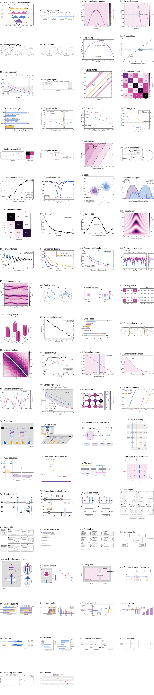
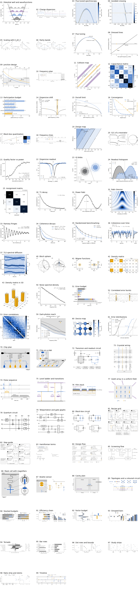
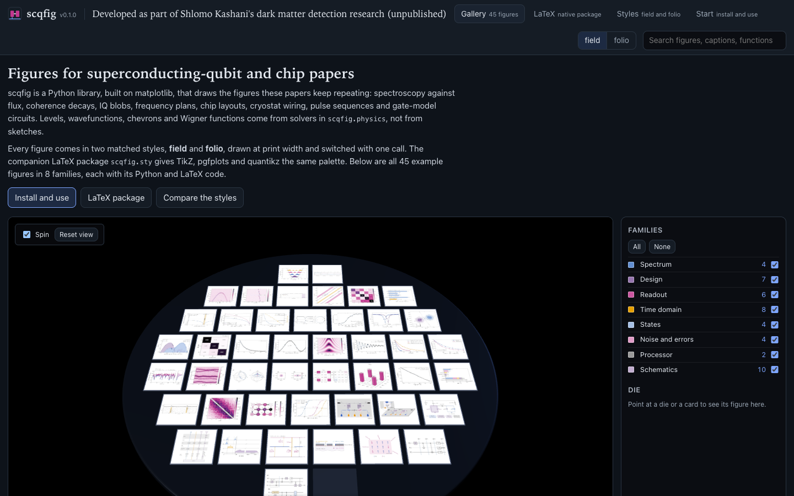
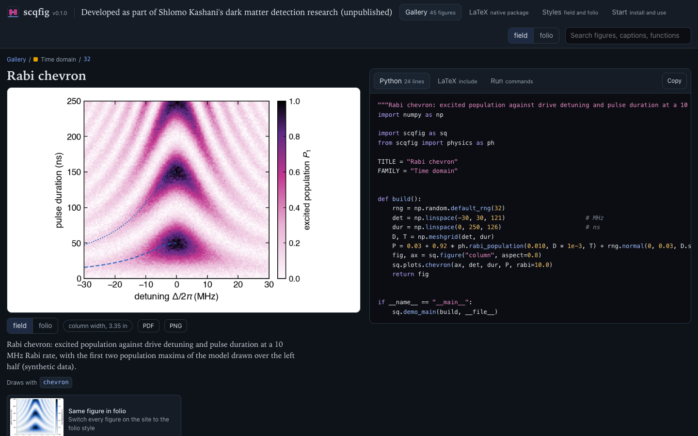
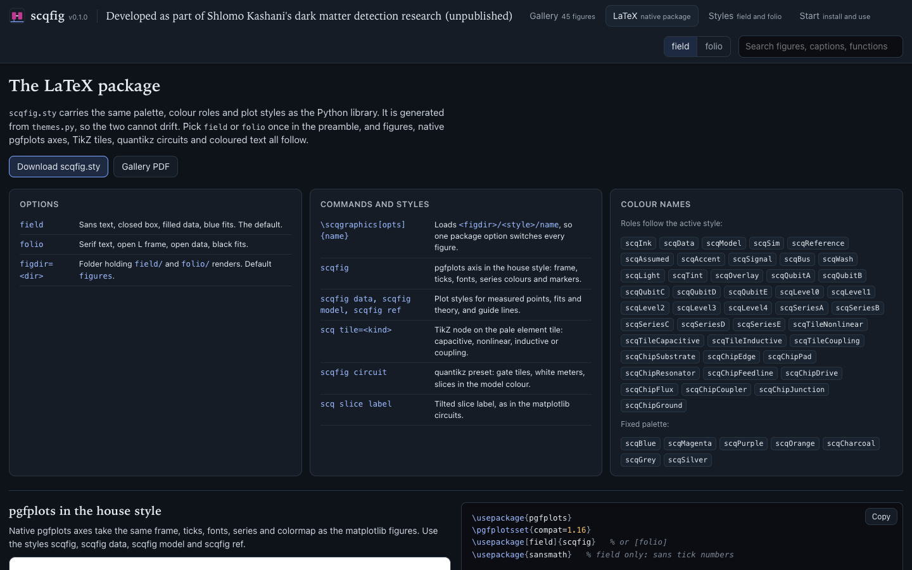
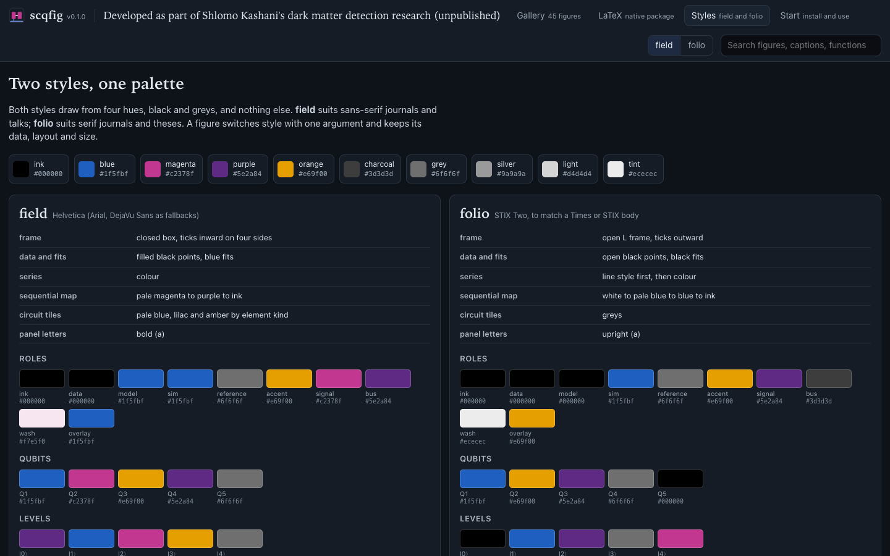

<div align="center">
  
  <h1>scqfig</h1>
  <code>v0.1.0</code>&nbsp;&nbsp;Python · matplotlib · LaTeX (TikZ, pgfplots, quantikz)
  <br><br>
  <p><b>Publication figures for superconducting-qubit and chip papers,<br>in two matched styles, with a companion LaTeX package.</b></p>
  <a href="https://boltzmannentropy.github.io/scqfig.github.io/"><strong>Open the gallery</strong></a>&nbsp;&nbsp;&nbsp;·&nbsp;&nbsp;&nbsp;<a href="gallery/gallery.pdf"><strong>Gallery PDF</strong></a>&nbsp;&nbsp;&nbsp;·&nbsp;&nbsp;&nbsp;<a href="#quick-start"><strong>Quick start</strong></a>
  <br><br>
  
  
  
  
  <br><br>
</div>

> **Research context.** scqfig was developed as part of Shlomo Kashani's research on dark matter
> detection. That research is not yet published. The example figures use synthetic, simulated,
> designed or computed values, not data from that work.

> **Spectroscopy** | **Coherence and benchmarking** | **Readout** | **Frequency plans** | **Chip plans** | **Cryostat wiring** | **Gate-model circuits**

scqfig is a Python library, built on matplotlib, that draws the figures a superconducting-chip paper
keeps repeating: spectroscopy and coherence decays, readout and benchmarking, frequency plans, chip
plans, cryostat wiring and gate-model circuits. Each plot type has a runnable example. Every figure
comes in two matched styles that you switch with one call, and a generated LaTeX package gives TikZ,
pgfplots and quantikz the same palette.

| field | folio |
|---|---|
|  |  |

The full catalogue, with every example in both styles side by side, is in
[`gallery/gallery.pdf`](gallery/gallery.pdf). The [website](https://boltzmannentropy.github.io/scqfig.github.io/)
shows each figure with its Python and LaTeX code.

## Website UI

The [gallery site](https://boltzmannentropy.github.io/scqfig.github.io/) lays the 47 example figures out as
dies on a three.js wafer. Pick a die to open its figure, switch every figure between field and
folio with one toggle, and copy the Python source or the LaTeX include.

<table>
  <tr>
    <td width="50%"><br><sub><b>Gallery.</b> One die per figure, filtered by family.</sub></td>
    <td width="50%"><br><sub><b>Figure page.</b> The figure, its caption, PDF and PNG downloads, and the Python, LaTeX and run commands.</sub></td>
  </tr>
  <tr>
    <td width="50%"><br><sub><b>LaTeX.</b> Native pgfplots, TikZ and quantikz in the same palette.</sub></td>
    <td width="50%"><br><sub><b>Styles.</b> The field and folio palettes and type side by side.</sub></td>
  </tr>
</table>

## Contents

- [Website UI](#website-ui)
- [Highlights](#highlights)
- [Why](#why)
- [Install](#install)
- [Quick start](#quick-start)
- [Two styles](#two-styles)
- [Use in LaTeX](#use-in-latex)
- [Gate-model circuits](#gate-model-circuits)
- [Package layout](#package-layout)
- [Plot catalogue](#plot-catalogue)
- [Rules the library keeps](#rules-the-library-keeps)
- [Development](#development)
- [Website](#website)
- [Contributing](#contributing)
- [Citing](#citing)
- [License](#license)

## Highlights

- **Computed physics.** `scqfig.physics` diagonalises the transmon in the charge basis and supplies
  dispersive shifts, Purcell limits, notch-resonator S21, Wigner functions and Rabi dynamics. The
  curves on a figure follow from its parameters.
- **Fits that report themselves.** `t1_decay`, `ramsey`, `rb` and `coherence_decays` fit the data,
  draw the fit and print each result with its error on the panel. They return the fit too.
- **Two matched styles.** field uses a sans face and a closed frame and separates series by colour.
  folio uses a serif face and an open frame and separates series by line style first.
- **Print size.** Figures are drawn at their printed width (`column`, `page` and the APS, Nature,
  IEEE and thesis widths in `scqfig.WIDTHS`), so they go into a paper without scaling.
- **Schematics.** Chip plans and oblique chip views, lumped circuits, cryostat wiring, pulse
  sequences, level ladders, film stacks and gate-model circuits.
- **A LaTeX companion.** `latex/scqfig.sty` comes from the same palette. One package option
  switches every figure in a paper between the styles, and presets give native pgfplots, TikZ and
  quantikz the matching look.
- **An enforced palette.** `scqfig.check.violations(fig)` flags any colour outside the palette, and
  the tests run it on every example in both styles.

## Why

A superconducting-chip paper draws the same figures again and again:
- spectroscopy against flux, avoided crossings and T1 decays;
- IQ blobs, frequency plans and chip layouts;
- wiring diagrams and pulse sequences.

Each group restyles them by hand, and the restyling rarely survives the next paper.

scqfig draws each of them in a consistent house style, at print size, from data you pass in.
Levels, wavefunctions, chevrons, Wigner functions and response curves come from solvers in
`scqfig.physics`, not from sketches.

## Install

```bash
pip install -e .            # from a checkout
pip install -e ".[test]"    # with pytest
```

scqfig is not on PyPI yet, so install it from a checkout of this repository.

It needs Python 3.9, numpy 1.22, scipy 1.8 and matplotlib 3.6, or any later version of each. LaTeX
is optional; you need it for the gallery PDF and for `usetex=True`.

## Quick start

```python
import numpy as np
import scqfig as sq

sq.use("folio")                                   # or "field"
t = np.linspace(0, 240, 41)
p = 0.93 * np.exp(-t / 48) + 0.03 + np.random.default_rng(0).normal(0, 0.01, t.size)

fig, ax = sq.figure("column", aspect=0.62)        # 3.4 in wide: drop in at \columnwidth
fit = sq.plots.t1_decay(ax, t, p)                 # draws data, fit and "T1 = 47.3 ± 0.6 µs"
sq.save(fig, "figures/t1")                        # figures/t1.pdf and figures/t1.png
print(fit["T"], fit.errors["T"])
```

Every plot function draws on an Axes you pass in and returns what you need next: the fit, the mesh
and colour bar, or the artists. Panels compose freely:

```python
fig, (a, b) = sq.figure("page", aspect=0.3, ncols=2)
sq.plots.ramsey(a, t, p_ramsey)
sq.plots.rb(b, m, seqs, interleaved=seqs_int)     # one row of survival per random sequence
sq.panel(a, "a"); sq.panel(b, "b")
```

## Two styles

| | field | folio |
|---|---|---|
| face | Helvetica (Arial and DejaVu Sans as fallbacks) | STIX Two, matching a Times or STIX body |
| frame | closed box, ticks inward on four sides | open L frame, ticks outward |
| measured points | filled black | open black |
| fits and theory | blue | black |
| several series | colour | line style first, then colour (`sq.series(i)`) |
| sequential map | pale magenta, magenta, purple, ink | white, pale blue, blue, ink |
| circuit tiles | pale blue, lilac and amber by element kind | greys |
| panel letters | bold (a) | upright (a) |

Switch a block of code temporarily with `with sq.style("field"): ...`. With `sq.use("folio",
usetex=True)`, LaTeX sets all text (`stix2`, or `helvet` with `sansmath`).

## Use in LaTeX

Figures are drawn at print width, so they go in without scaling. `sq.figure("column")` is 3.4 in
and `sq.figure("page")` is 7.0 in. `scqfig.WIDTHS` adds APS, Nature, IEEE and thesis widths.

`latex/scqfig.sty` is generated from the same palette (`python -m scqfig.latex`):

```latex
\usepackage[folio,figdir=figures]{scqfig}   % or [field]
...
\scqgraphics[width=\columnwidth]{t1_decay}  % loads figures/folio/t1_decay
\textcolor{scqAccent}{allowed transition}   % the active style's roles
\begin{axis}[scqfig] \addplot+[scqfig data] table {t1.dat}; \end{axis}   % native pgfplots in the same style
```

Render both styles into `figures/field/` and `figures/folio/`. The package option then switches
every figure in the paper at once.

## Gate-model circuits

`QCircuit` draws digital circuits in the same two styles:

```python
from scqfig.schematics import QCircuit

c = QCircuit(3, labels=[r"$|0\rangle$"] * 3)
c.gate("H", 0);       c.slice(r"$\Psi_1$")
c.cnot(0, 1);         c.slice(r"$\Psi_2$")
c.cnot(0, 2);         c.slice(r"$\Psi_3$")
c.measure([0, 1, 2]); c.slice(r"$\Psi_4$")
w, h = c.figsize()                                # the circuit sizes its own figure
fig, ax = sq.figure(w, height=h)
c.draw(ax)
```

Each operation takes the first column that is free on every wire it spans, and a slice keeps later
operations to its right. `gate`, `multi`, `cnot`, `controlled` (with `open_controls`), `cz`, `swap`,
`measure`, `slice` and `group` cover the usual glyphs. A measured wire turns into a classical double
line, and `gate("X", 2, cond=1)` hangs a gate on the bit that wire 1 measured (example 79).

field puts gates on rounded lilac tiles, rotations on amber and multi-qubit boxes on pale blue, and
draws slices in blue. folio draws square grey gates and ink slices. Both styles use white meters,
grey dashed groups and slice labels tilted by 30 degrees.

To typeset a circuit in LaTeX instead, load quantikz next to the package and pass `scqfig circuit`:

```latex
\usepackage{quantikz}
\usepackage[field]{scqfig}
...
\begin{quantikz}[scqfig circuit]          % or [scqfig circuit field] / [scqfig circuit folio]
\lstick{$|0\rangle$} & \gate{H}\slice[label style=scq slice label]{$\Psi_1$} & \ctrl{1} & \meter{} \\
\lstick{$|0\rangle$} & \qw                                                   & \targ{}  & \meter{}
\end{quantikz}
```

The preset replaces quantikz's red slices with the style's model colour. `scq slice label` tilts one
slice label; under `slice all` every label tilts by itself. Tested with quantikz 0.9.6.

## Package layout

| Module | What it holds |
|---|---|
| `scqfig` | `use`, `style`, `figure`, `panel`, `save`, `series`, `WIDTHS` and the two themes |
| `scqfig.plots` | one function per plot type, grouped in `spectrum`, `design`, `readout`, `timedomain`, `states`, `noise` and `processor` |
| `scqfig.physics` | solvers behind the plots: `transmon_levels`, `charge_dispersion`, `dispersive_shift`, `purcell_t1`, `notch_s21`, `wigner`, `rabi_population` and more |
| `scqfig.fit` | the fit models and a `Fit` result that carries values and errors |
| `scqfig.schematics` | `chip`, `wiring`, `pulses`, `symbols`, `motifs` and `QCircuit` |
| `scqfig.check` | the palette checker |
| `scqfig.latex` | writes `latex/scqfig.sty` from the palette |

## Plot catalogue

`examples/build_gallery.py` writes this table from the examples themselves. Edit the example's
docstring and `TITLE`, not the table.

<!-- catalogue:start -->
| # | Plot | What it shows | Example |
|---|---|---|---|
| 01 | Potential well and wavefunctions | Transmon potential with the four lowest levels and their computed \|psi(phi)\|^2 (charge basis, E_J/E_C = 80). | [`01_potential_well.py`](examples/01_potential_well.py) |
| 02 | Charge dispersion | Charge dispersion of the three lowest levels as E_J/E_C grows from the Cooper-pair box to the transmon. | [`02_charge_dispersion.py`](examples/02_charge_dispersion.py) |
| 03 | Flux-tuned spectroscopy | Two-tone spectroscopy of a SQUID transmon against flux, with the exact f01 and f02/2 drawn over the data (synthetic data). | [`03_flux_spectroscopy.py`](examples/03_flux_spectroscopy.py) |
| 04 | Avoided crossing | Vacuum-Rabi splitting: resonator transmission as a tunable qubit crosses it, with the bare modes dashed and 2g marked (synthetic data). | [`04_avoided_crossing.py`](examples/04_avoided_crossing.py) |
| 10 | Frequency plan | Frequency plan of a three-qubit chain: each transmon's f01 and f12, the readout resonators inside the Purcell-filter passband, and the collision windows each qubit's f01 must avoid (designed values). | [`10_frequency_plan.py`](examples/10_frequency_plan.py) |
| 11 | Collision map | Collision map of two coupled transmons: forbidden bands of the f_q2 against f_q1 plane, with three design points and their 20 MHz fabrication scatter; one point sits on a two-photon band (designed values). | [`11_collision_map.py`](examples/11_collision_map.py) |
| 12 | Capacitance matrix | Maxwell capacitance matrix of two transmons, their readout resonators and the feedline, coloured by \|C\| on a log scale (simulated values). | [`12_capacitance_matrix.py`](examples/12_capacitance_matrix.py) |
| 13 | Participation budget | Surface-participation loss budget of a transmon: participation and loss tangent of each region, the quality factor each allows, and the total (simulated participation, assumed loss tangents). | [`13_participation.py`](examples/13_participation.py) |
| 14 | Dispersive shift | Dispersive shift of a transmon against its frequency for a 7.15 GHz resonator, g = 85 MHz and alpha = -233 MHz, with the straddling regime shaded and the design point marked (computed). | [`14_dispersive_shift.py`](examples/14_dispersive_shift.py) |
| 15 | Purcell limit | Purcell limit on T1 against qubit frequency for a 7.15 GHz readout resonator (kappa = 1.5 MHz, g = 85 MHz), without and with a Q = 25 bandpass filter (computed). | [`15_purcell_limit.py`](examples/15_purcell_limit.py) |
| 16 | Convergence | Eigenmode frequency of a readout resonator against adaptive mesh pass, with the relative change per pass and a 0.02 % target (synthetic data). | [`16_convergence.py`](examples/16_convergence.py) |
| 17 | Black-box quantization | Black-box quantization of the transmon and readout resonator of example 72: (a) the susceptance the junction sees, whose rising zeros are the modes and whose slopes set their impedances; (b) the first-order Kerr matrix, with exact diagonalization of the same circuit in brackets (computed). | [`17_black_box.py`](examples/17_black_box.py) |
| 20 | S21 of a resonator | Notch-resonator transmission as magnitude, phase and circle, with one complex fit and the cable delay, amplitude and phase calibrated out (synthetic data). | [`20_s21_resonator.py`](examples/20_s21_resonator.py) |
| 21 | Quality factor vs power | Internal quality factor of a resonator against mean photon number, with a fit of the saturable two-level-system model (synthetic data). | [`21_quality_vs_power.py`](examples/21_quality_vs_power.py) |
| 22 | Dispersive readout | Dispersive readout: resonator transmission with the qubit in \|0> and in \|1>, the 2chi shift computed for g = 85 MHz and Delta = -2.09 GHz, and the readout frequency between the two dips (synthetic data). | [`22_dispersive_readout.py`](examples/22_dispersive_readout.py) |
| 23 | IQ blobs | Single-shot readout in the IQ plane: 4000 shots per prepared state with 1 and 2 sigma contours and the discrimination line; the \|1> shots include T1 decay during the 1.5 us integration (synthetic data). | [`23_iq_blobs.py`](examples/23_iq_blobs.py) |
| 24 | Readout histogram | Single-shot histograms projected on the discrimination axis, with Gaussian fits to each peak and the assignment fidelity; the tail between the peaks is T1 decay during readout (synthetic data). | [`24_readout_histogram.py`](examples/24_readout_histogram.py) |
| 25 | Assignment matrix | Three-state assignment matrix from 5000 simulated shots per prepared state, assigned to the nearest IQ centre; decay during readout fills the lower triangle (synthetic data). | [`25_assignment_matrix.py`](examples/25_assignment_matrix.py) |
| 30 | T1 decay | Energy relaxation: excited-state population against delay with an exponential fit (synthetic data, T1 = 48 us). | [`30_t1_decay.py`](examples/30_t1_decay.py) |
| 31 | Power Rabi | Power Rabi: excited population against drive amplitude for a 40 ns pulse, with a cosine fit and the pi-pulse amplitude (synthetic data). | [`31_rabi.py`](examples/31_rabi.py) |
| 32 | Rabi chevron | Rabi chevron: excited population against drive detuning and pulse duration at a 10 MHz Rabi rate, with the first two population maxima of the model drawn over the left half (synthetic data). | [`32_chevron.py`](examples/32_chevron.py) |
| 33 | Ramsey fringes | Ramsey fringes at 0.8 MHz detuning with a damped-cosine fit and its envelope (synthetic data, T2* = 4.2 us). | [`33_ramsey.py`](examples/33_ramsey.py) |
| 34 | Coherence decays | Ramsey envelope, Hahn echo and CPMG-16 decays of one qubit on one axis, each with its exponential fit and time constant (synthetic data). | [`34_coherence_decays.py`](examples/34_coherence_decays.py) |
| 35 | Randomized benchmarking | Standard and interleaved randomized benchmarking of an X gate, 30 random sequences per length, with the error per Clifford and the interleaved gate error (synthetic data). | [`35_rb.py`](examples/35_rb.py) |
| 36 | Coherence over time | T1 and echo T2 measured every 10 minutes for 48 hours, with their histograms; T1 drops whenever a wandering defect drifts onto the qubit frequency (synthetic data). | [`36_coherence_timeseries.py`](examples/36_coherence_timeseries.py) |
| 37 | TLS spectral diffusion | T1 against qubit frequency over 24 hours; five defects show as Lorentzian T1 dips whose frequencies wander, and one switches between two frequencies (synthetic data). | [`37_tls_map.py`](examples/37_tls_map.py) |
| 40 | Bloch sphere | Bloch sphere: (a) a detuned Rabi drive (Delta = 0.6 Omega) tilts the precession cone off the pole; (b) free precession from \|+> spirals to \|0> as T2 and T1 shrink the vector (computed). | [`40_bloch_sphere.py`](examples/40_bloch_sphere.py) |
| 41 | Wigner functions | Wigner functions of (a) the Fock state \|1> and (b) an even cat state with alpha = 2, on one colour scale of +-2/pi (computed). | [`41_wigner.py`](examples/41_wigner.py) |
| 42 | Density matrix | Two-qubit tomography of the Bell state (\|00> + \|11>)/sqrt(2): real and imaginary parts of the reconstructed density matrix (synthetic data). | [`42_density_matrix.py`](examples/42_density_matrix.py) |
| 43 | Density matrix in 3D | Real part of the reconstructed Bell-state density matrix as 3D bars, with the ideal state as wireframe outlines (synthetic data). | [`43_density_bars3d.py`](examples/43_density_bars3d.py) |
| 50 | Noise spectral density | Flux-noise spectral density with a power-law fit, amplitude at 1 Hz and a white floor (synthetic data). | [`50_noise_psd.py`](examples/50_noise_psd.py) |
| 51 | Error budget | CZ-gate error budget: contributions, their sum, and the measured error with the unexplained part hatched. | [`51_error_budget.py`](examples/51_error_budget.py) |
| 52 | Correlated error bursts | Correlated error bursts: detections per qubit over time, with the flagged fraction and burst marks above (synthetic data from a toy burst model). | [`52_burst_raster.py`](examples/52_burst_raster.py) |
| 53 | Error correlations | Pairwise correlation of error detections across a 24-qubit chain; bursts correlate neighbours (synthetic data from a toy burst model). | [`53_error_correlation.py`](examples/53_error_correlation.py) |
| 60 | Device map | Device map of a 3 x 4 qubit grid with T1 on the qubits and CZ error on the couplers (synthetic data). | [`60_device_map.py`](examples/60_device_map.py) |
| 61 | Error distributions | Cumulative distributions of single-qubit, CZ and readout errors across a 54-qubit processor, medians marked (synthetic data). | [`61_error_cdf.py`](examples/61_error_cdf.py) |
| 70 | Chip plan | Plan view of a two-qubit chip: Xmons joined by a tunable coupler, readout resonators on a feedline, drive and flux lines, airbridges. | [`70_chip_plan.py`](examples/70_chip_plan.py) |
| 71 | Chip on a slab | The two-qubit chip of example 70 laid on a slab by one rigid oblique map, with a plan-view zoom on the SQUID of Q1. | [`71_chip_oblique.py`](examples/71_chip_oblique.py) |
| 72 | Transmon and readout circuit | Lumped circuit of a transmon coupled to a quarter-wave readout resonator on a feedline, each Hamiltonian term on the tile of the element that produces it. | [`72_lumped_circuit.py`](examples/72_lumped_circuit.py) |
| 73 | Cryostat wiring | Wiring of a dilution refrigerator: attenuated and filtered XY, Z and readout-input lines, and a readout output through isolators, a TWPA and a HEMT. | [`73_cryostat_wiring.py`](examples/73_cryostat_wiring.py) |
| 74 | Pulse sequence | Pulse sequence of a conditional-phase measurement: DRAG pulses on two qubits, a CZ flux pulse and a dispersive readout with its integration window. | [`74_pulse_sequence.py`](examples/74_pulse_sequence.py) |
| 75 | Level ladder and transitions | Transmon ladder (E_J/E_C = 40) to scale, with drive photons for f01, f12 and the two-photon f02/2, and the parity-forbidden single-photon 0-2 transition. | [`75_level_ladder.py`](examples/75_level_ladder.py) |
| 76 | Film stack | Cross-section of a tantalum CPW on silicon with its metal-air, metal-substrate and substrate-air interfaces marked. | [`76_film_stack.py`](examples/76_film_stack.py) |
| 77 | Qubit array in a uniform field | A 3 x 4 qubit array drawn as spins in a uniform field (the wash), with photons arriving from several directions and three qubits excited. | [`77_spin_array.py`](examples/77_spin_array.py) |
| 78 | Quantum circuit | GHZ-state preparation: a Hadamard and two CNOTs entangle three qubits, then all three are measured; dashed slices mark the states Psi_1 to Psi_4. | [`78_quantum_circuit.py`](examples/78_quantum_circuit.py) |
| 79 | Teleportation and gate glyphs | (a) Teleportation: a Bell pair, a Bell measurement and classically controlled X and Z corrections. (b) The other gate glyphs: rotation, controlled-U with an open control, CZ, SWAP and a three-qubit box. | [`79_teleportation.py`](examples/79_teleportation.py) |
| 80 | Black-box circuit | Black-box quantization in four steps for the device of example 72: (a) the transmon coupled to its readout resonator; (b) the junction split into its linear inductance and its nonlinear remainder; (c) the linear part as one admittance, probed by a swept current source; (d) that admittance beside the nonlinear element, whose zero-point phase each mode sets (computed). | [`80_black_box_circuit.py`](examples/80_black_box_circuit.py) |
<!-- catalogue:end -->

## Rules the library keeps

- **Colour.** Every colour is blue `#1f5fbf`, magenta `#c2378f`, purple `#5e2a84` or orange
  `#e69f00`, a tint of one, or a grey.
  - Nothing reads as green or red, and colormaps stay in the blue to magenta range or in orange
    tints.
  - `scqfig.check.violations(fig)` lists any artist that breaks the rule, and the tests run it on
    every example in both styles.
- **Physics.** Wavefunctions, spectra and response curves are computed. A chip is a rigid drawing
  laid on the page by one affine map. A uniform field is a colour wash, never a local glow.
- **Print size.** Font sizes in `themes.py` are the printed sizes.

## Development

```text
src/scqfig/     the library (plots/, schematics/, physics, fit, themes, check, latex)
examples/       one runnable script per plot type, plus build_gallery.py
gallery/        rendered figures in both styles, contact sheets and gallery.pdf
latex/          scqfig.sty, generated by python -m scqfig.latex
tests/          pytest suite
tools/          build_site.py for the website
docs/           the GitHub Pages site
```

```bash
pip install -e ".[test]"                   # editable install with pytest
python examples/build_gallery.py           # every example in both styles, contact sheets, gallery.pdf
python examples/build_gallery.py --only 31 # one example
python examples/31_rabi.py --style folio   # a single figure next to the script
python -m scqfig.latex                     # regenerate latex/scqfig.sty after a palette change
PYTHONPATH=src python -m pytest -q         # physics, fits, styles, LaTeX, every example in both styles
```

## Website

`docs/` holds a static site for GitHub Pages: every example figure in both styles with its Python
source, a LaTeX include snippet and the commands to run it, the native pgfplots, TikZ and quantikz
styles, and both palettes. The gallery opens on a three.js wafer with one die per figure and falls
back to a plain grid without WebGL.

```bash
python examples/build_gallery.py   # render the figures first
python tools/build_site.py         # copy them into docs/ and write docs/data/site.json
python -m http.server -d docs 8000 # preview at http://localhost:8000
sh tools/publish_site.sh           # push docs/ to the public site repository
```

The site lives in its own public repository,
[BoltzmannEntropy/scqfig.github.io](https://github.com/BoltzmannEntropy/scqfig.github.io), and
GitHub Pages serves it at <https://boltzmannentropy.github.io/scqfig.github.io/>.
`tools/publish_site.sh` replaces that repository's contents with `docs/` (leaving out
`docs/review/`). `docs/assets/screens/` holds the screenshots this README shows.

## Contributing

[CONTRIBUTING.md](CONTRIBUTING.md) covers the layout, the plot-function and example templates, the
marker grammar and the checks a new plot type must pass.

## Citing

If scqfig drew figures in your paper, please cite it:

```bibtex
@software{kashani_scqfig_2026,
  author  = {Kashani, Shlomo},
  title   = {scqfig: publication figures for superconducting-qubit and chip papers},
  year    = {2026},
  version = {0.1.0}
}
```

## License

MIT, see [LICENSE](LICENSE).
